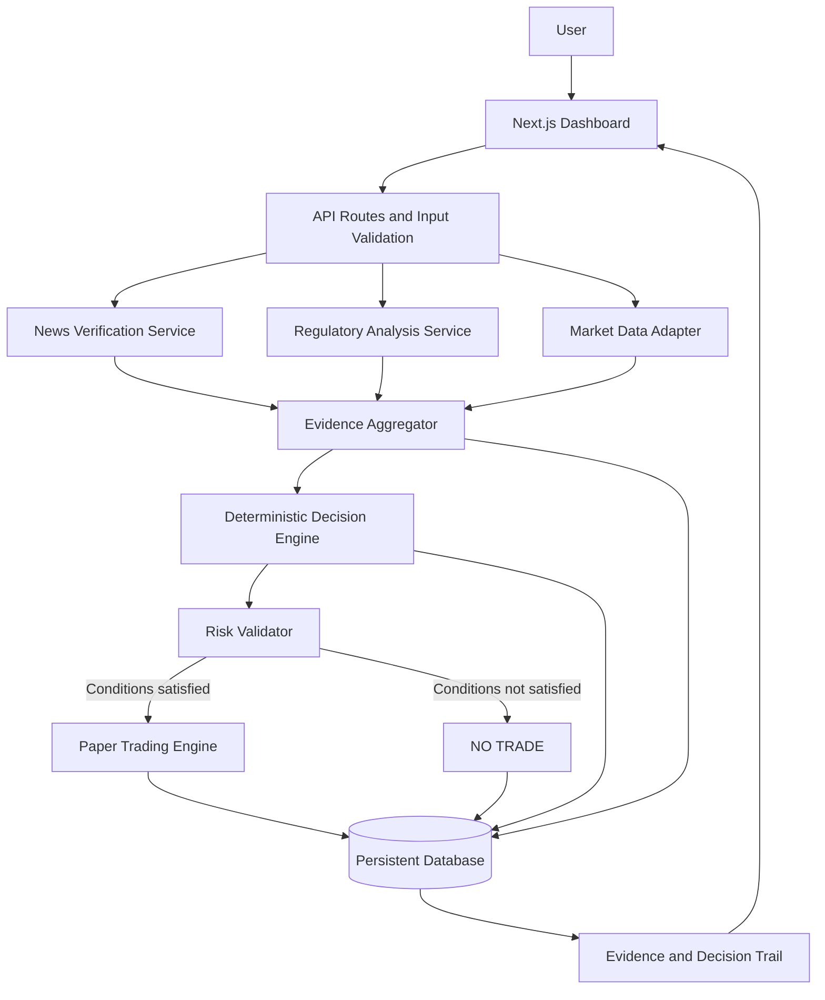

# LexiTrade AI — System Architecture

## 1. Overview

LexiTrade AI is an AI-assisted autonomous agent that connects cryptocurrency regulatory news with market evidence, applies deterministic trading rules, and records simulated trades with an inspectable decision trail.

The architecture separates source retrieval, AI analysis, deterministic decisions, risk validation, paper trading, and persistence. This separation makes the system easier to test and allows data providers to be changed without rewriting the decision engine.

Direct RYO-CHAN API or MCP integration is not assumed to be mandatory based on the currently available bounty description. The architecture supports a provider adapter so RYO-CHAN can be added if appropriate, accessible, or required by confirmed sponsor rules.

## 2. Architecture Diagram



## 3. Technology Stack

### Frontend
- Next.js
- React
- TypeScript
- Tailwind CSS

### Backend
- Next.js Route Handlers
- TypeScript
- Zod for input and response validation

### AI
- One LLM provider with structured output.
- AI is used for news interpretation and structured assessments, not as the sole authority for verifying facts or executing decisions.

### Market Intelligence
- A documented and accessible market-data provider.
- Provider-specific adapter interface.
- RYO-CHAN can be implemented as an adapter if the integration method and requirements are confirmed.

### Persistence
- SQLite or another suitable persistent database for the initial deployment.
- The final choice depends on the deployment environment and persistence requirements.

### Testing
- Unit tests for decision rules and risk validation.
- Integration tests for external providers and persistence.
- End-to-end tests for the primary workflow.

## 4. Core Components

### 4.1 Dashboard

Responsibilities:
- Accept a news claim and optional source URL.
- Display source-verification status.
- Display market observations and their timestamps.
- Present structured AI analysis.
- Show BUY or NO TRADE and the applicable rule results.
- Display paper-trade status and history.
- Allow users to inspect past analyses and decision records.

The dashboard must distinguish facts, AI assessments, and deterministic decisions.

### 4.2 API Layer

Responsibilities:
- Validate incoming requests.
- Coordinate application services.
- Enforce request limits and server-side access to secrets.
- Return validated responses.
- Handle provider errors without exposing credentials or internal stack traces.

### 4.3 News Verification Service

Responsibilities:
- Retrieve or process the submitted news source using a supported method.
- Record source references and timestamps.
- Assess whether available evidence supports the submitted claim.
- Identify material conflicts between credible sources.
- Return a structured verification result.

Verification statuses:
- `VERIFIED`
- `UNVERIFIED`
- `CONFLICTING`
- `UNAVAILABLE`

The service must not equate an LLM's confidence with factual verification.

### 4.4 Regulatory Analysis Service

Responsibilities:
- Identify the primary claim.
- Extract relevant jurisdiction, entities, and affected assets where possible.
- Assess potential regulatory and market implications.
- Produce structured sentiment and uncertainty.
- Distinguish source-backed facts from inferred implications.

Suggested sentiment values:
- `BULLISH`
- `BEARISH`
- `NEUTRAL`
- `UNCERTAIN`

Suggested regulatory-risk values:
- `LOW`
- `MEDIUM`
- `HIGH`
- `UNKNOWN`

### 4.5 Market Data Adapter

Responsibilities:
- Retrieve market observations from the configured provider.
- Normalize provider responses.
- Validate data types and numeric values.
- Record provider name, observation time, and retrieval time.
- Enforce data-freshness requirements.
- Return explicit errors when data is unavailable.

The internal adapter contract should be independent of the external provider.

Potential interface:

```typescript
type MarketObservation = {
  asset: string;
  price: number;
  observedAt: string;
  retrievedAt: string;
  provider: string;
  metrics?: Record<string, number | string | null>;
};

interface MarketDataProvider {
  getMarketEvidence(
    asset: string
  ): Promise<MarketObservation[]>;
}
```

This is a proposed internal interface. Actual supported fields and provider capabilities must be verified before implementation.

### 4.6 Evidence Aggregator

Responsibilities:
- Combine news-verification results, regulatory analysis, and market observations.
- Check that evidence is sufficiently complete and current.
- Identify missing or conflicting inputs.
- Produce a normalized evidence package.
- Preserve source references and timestamps.

The aggregator must not silently substitute invented or stale values when required data is unavailable.

### 4.7 Deterministic Decision Engine

Responsibilities:
- Evaluate normalized evidence against a versioned strategy.
- Produce BUY or NO TRADE for the initial MVP.
- Record rule evaluation results.
- Generate a structured decision explanation based on recorded evidence and rule outcomes.
- Produce the same engine result for the same normalized inputs and strategy version.

The LLM may assist with interpretation, but the final decision must pass through explicit deterministic rules.

### 4.8 Risk Validator

Responsibilities:
- Validate position size.
- Validate stop-loss and take-profit parameters.
- Enforce configured position and loss limits.
- Reject trades when mandatory inputs are missing or invalid.
- Return a clear rejection reason.

Risk validation must occur before any paper trade is created.

### 4.9 Paper Trading Engine

Responsibilities:
- Use virtual funds only.
- Create simulated positions from approved decisions.
- Apply documented entry-price and exit-price rules.
- Evaluate stop-loss and take-profit conditions against subsequent observations.
- Calculate simulated P/L.
- Record trade lifecycle events.

The system must not describe simulated prices as actual exchange fills.

### 4.10 Evidence and Decision Trail

Responsibilities:
- Persist the submitted claim and its source.
- Store verification and analysis results.
- Record market observations and timestamps.
- Record strategy version and evaluated conditions.
- Store the final decision and risk-validation outcome.
- Link simulated trades to their originating decisions.
- Preserve subsequent trade updates and outcomes.

The trail should explain the decision through evidence and rule outcomes rather than expose or fabricate hidden LLM reasoning.

## 5. Data Models

The following are proposed logical models. They may be adjusted during implementation.

### Analysis

```typescript
type Analysis = {
  id: string;
  claim: string;
  sourceUrl?: string;
  createdAt: string;
  verificationStatus:
    | "VERIFIED"
    | "UNVERIFIED"
    | "CONFLICTING"
    | "UNAVAILABLE";
  sentiment:
    | "BULLISH"
    | "BEARISH"
    | "NEUTRAL"
    | "UNCERTAIN";
  regulatoryRisk:
    | "LOW"
    | "MEDIUM"
    | "HIGH"
    | "UNKNOWN";
  summary: string;
  uncertaintyNotes: string[];
};
```

### Evidence

```typescript
type Evidence = {
  id: string;
  analysisId: string;
  type: "NEWS_SOURCE" | "MARKET_OBSERVATION" | "OTHER";
  provider: string;
  sourceUrl?: string;
  observedAt?: string;
  retrievedAt: string;
  payload: Record<string, unknown>;
};
```

### Decision

```typescript
type Decision = {
  id: string;
  analysisId: string;
  strategyVersion: string;
  outcome: "BUY" | "NO_TRADE";
  evaluatedAt: string;
  evidenceIds: string[];
  ruleResults: Array<{
    ruleId: string;
    passed: boolean;
    explanation: string;
  }>;
  rejectionReasons: string[];
};
```

### PaperTrade

```typescript
type PaperTrade = {
  id: string;
  decisionId: string;
  asset: string;
  direction: "LONG";
  entryPrice: number;
  positionSize: number;
  stopLoss: number;
  takeProfit: number;
  openedAt: string;
  closedAt?: string;
  exitPrice?: number;
  pnl?: number;
  status: "OPEN" | "CLOSED" | "CANCELLED";
};
```

The models must be validated at runtime. Additional fields may be required for fees, virtual balances, position-sizing assumptions, and price-source metadata.

## 6. Proposed API Routes

These routes are proposed internal endpoints, not existing integrations with RYO-CHAN.

| Method | Endpoint | Purpose |
|---|---|---|
| POST | `/api/analyze` | Verify a claim, gather evidence, analyze, and evaluate a decision |
| GET | `/api/analyses` | Retrieve analysis history |
| GET | `/api/analyses/[id]` | Retrieve an analysis and its evidence trail |
| GET | `/api/market/[asset]` | Retrieve supported market evidence |
| GET | `/api/trades` | Retrieve paper-trade history |
| POST | `/api/trades/[id]/close` | Close a paper trade using the documented simulation rules |

Additional routes may be introduced when needed, but the MVP should avoid unnecessary API complexity.

## 7. Error Handling

The application must handle:
- Unavailable news sources.
- Conflicting source information.
- Market-data provider timeouts.
- Rate limits and authentication errors.
- Stale market observations.
- Invalid or incomplete LLM output.
- Failed validation.
- Database errors.
- Duplicate analysis or trade requests.

If mandatory evidence cannot be obtained, the system must return an explicit failure or NO TRADE result as appropriate. It must never fabricate evidence to complete the workflow.

## 8. Security and Integrity

- Store credentials only on the server.
- Use environment variables for secrets.
- Validate user inputs and external responses.
- Do not request private wallet keys.
- Do not execute real trades.
- Preserve source references and timestamps.
- Version decision rules.
- Keep simulation assumptions explicit.

A future integrity feature could hash a saved decision record. Such a hash may help detect record modification, but it does not prove that the original news or market data was truthful.

## 9. Testing Strategy

### Unit Tests
- Verification-state handling.
- Market-data validation and freshness.
- Decision-rule evaluation.
- Risk-limit enforcement.
- Position sizing and P/L calculations.

### Integration Tests
- Market provider adapter.
- News-source retrieval.
- Database persistence.
- Analysis-to-decision relationships.
- Decision-to-paper-trade relationships.

### End-to-End Tests
- Valid evidence produces an eligible decision and paper trade.
- Unverified news cannot bypass required verification conditions.
- Missing or stale market data produces a safe outcome.
- Conflicting evidence is surfaced.
- Saved decisions can be inspected after the workflow completes.

## 10. Deployment Considerations

The deployment environment must support:
- Server-side execution of API routes.
- Secure environment-variable configuration.
- Persistent database storage.
- Outbound requests to the selected data providers.
- Suitable request timeouts and rate-limit handling.

The database choice must be compatible with the selected hosting platform. An ephemeral local filesystem must not be treated as durable storage.

## 11. Open Decisions

Before implementation, confirm:
- BLI and sponsor submission requirements.
- The selected market-data provider and its actual schema.
- Whether direct RYO-CHAN integration is required or beneficial.
- The supported method for news verification.
- LLM provider and structured-output format.
- Database and hosting platform.
- Strategy conditions, freshness thresholds, and risk parameters.
- Expected demo and submission deliverables.

## 12. Definition of Done

The architecture is successfully implemented when a user can submit a regulatory news claim, inspect its verification status and supporting evidence, review actual market observations, receive a deterministic BUY or NO TRADE decision, simulate an eligible trade, and inspect the saved decision trail.

The complete workflow must be testable, reproducible within documented limitations, and demonstrable without real-money trading.
