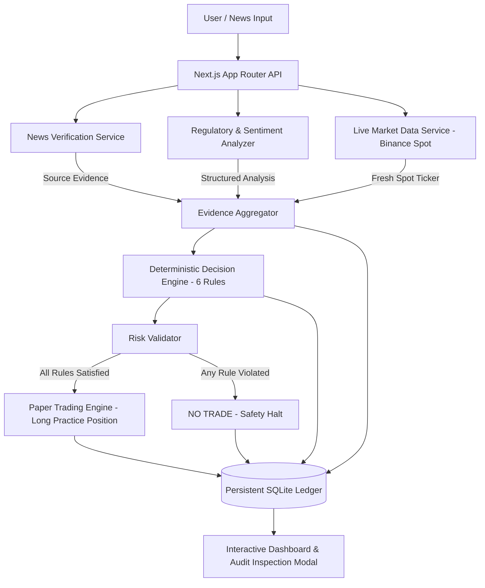

# LexiTrade AI

> **From Regulatory News to Explainable Practice Trades**  
> *Target Bounty:* Autonomous Agents (RYO-CHAN) — **BLI Legal Tech Hackathon 2 (DoraHacks)**

[](https://nextjs.org/)
[](https://www.typescriptlang.org/)
[](https://tailwindcss.com/)
[-003B57?style=flat&logo=sqlite)](https://sqlite.org/)
[](https://vitest.dev/)

---

## 1. Overview & Problem Statement

Cryptocurrency market participants frequently struggle to distinguish between verified regulatory rulings and unverified rumors, and AI trading recommendations are often untrusted "black boxes" that hallucinate facts or execute high-risk trades without explicit evidence.

**LexiTrade AI** solves this by creating an **auditable, autonomous agent pipeline**:
1. It ingests cryptocurrency regulatory news claims.
2. It fetches and verifies independent source evidence, distinguishing between `VERIFIED`, `UNVERIFIED`, `CONFLICTING`, and `UNAVAILABLE`.
3. It retrieves live, verifiable market evidence (Binance Spot and CoinPaprika fallback).
4. It evaluates an explicit **6-rule deterministic decision engine** (Version `v1.0.0`) producing strictly repeatable `BUY` or `NO TRADE` outcomes.
5. If all conditions pass, it simulates a practice trade with strict risk limits (stop-loss, take-profit, position sizing).
6. It permanently records every step into an **inspectable decision ledger**.

> [!IMPORTANT]
> **Safety & Responsible AI:** LexiTrade AI executes **virtual practice trades only**. It does not handle private wallet keys, execute real exchange orders, or make promises of financial profitability.

---

## 2. System Architecture



---

## 3. The 6 Deterministic Decision Rules

Unlike black-box AI traders, LexiTrade AI evaluates explicit versioned rules:

| Rule ID | Condition | Purpose |
|---|---|---|
| `RULE_VERIFIED_NEWS` | Status == `VERIFIED` | Rejects trading on uncorroborated social rumors or dead links |
| `RULE_BULLISH_SENTIMENT` | Sentiment == `BULLISH` | Requires positive regulatory catalyst for long positions |
| `RULE_ACCEPTABLE_REGULATORY_RISK` | Risk $\in$ `[LOW, MEDIUM]` | Prohibits entries when regulatory risk is `HIGH` (e.g. criminal indictments) |
| `RULE_VALID_MARKET_EVIDENCE` | Price > 0 & Age $\le$ 300s | Rejects stale, manipulated, or unavailable market data |
| `RULE_MARKET_TREND_STABILITY` | 24h Change $\ge$ -5.0% | Prevents entering long positions during violent counter-trend dumps |
| `RULE_RISK_LIMITS` | Valid SL/TP & $\le$ 10% portfolio | Enforces Stop-Loss (-3%), Take-Profit (+6%), and 2:1 Risk/Reward ratio |

---

## 4. Key Features

- **Multi-Status Verification Engine:** Automatically parses source HTML with `cheerio`, extracts metadata, calculates keyword corroboration, and detects contradictory statements (e.g., claiming approval when the source reports denial).
- **Dual-Mode Regulatory Analysis:**
  - *Deterministic Heuristic Engine:* 100% offline-capable, extracting entities (`BTC`, `ETH`, `SOL`, etc.), jurisdictions (`US`, `EU`, `UK`, `Singapore`), sentiments, and uncertainty notes without third-party API dependencies.
  - *LLM Structured Provider:* Optional Gemini or OpenAI JSON mode if API keys are configured.
- **Zero-Auth Real-Time Market Evidence:** Fetches spot ticker prices, 24-hour volume, and price change from Binance Spot API with automated fallback to CoinPaprika.
- **Persistent Decision & Evidence Trail:** SQLite database storing analyses, raw evidence payloads, strategy versions, evaluated rule results, and simulated paper trade lifecycles.
- **Interactive Web3/FinTech Terminal:** Complete Next.js dashboard featuring one-click demo presets, real-time status badges, paper trade closing, and full audit record inspection modals.

---

## 5. Quick Start & Installation

### Prerequisites
- Node.js `v20+` or `v24+`
- npm `v10+`

### Setup
```bash
# 1. Clone repository
git clone https://github.com/Khilmi-Wahyu-Saputra/lexitrade-ai.git
cd lexitrade-ai

# 2. Install dependencies
npm install

# 3. Configure environment
cp .env.example .env.local

# 4. Run test suite (33 unit & E2E tests)
npm test

# 5. Start development server
npm run dev
```

Open [http://localhost:3000](http://localhost:3000) in your browser.

---

## 6. Pre-Configured Demo Scenarios

The dashboard provides 3 interactive 1-click presets demonstrating the full autonomous workflow:

1. 🟢 **Scenario 1: Verified Spot ETF Approval (Eligible BUY)**
   - *Claim:* "Securities and Exchange Commission grants formal regulatory approval for Bitcoin spot ETF listing and trading across US national exchanges."
   - *Result:* `VERIFIED` $\rightarrow$ `BULLISH` $\rightarrow$ Real Binance BTC Spot Data $\rightarrow$ **`BUY` Decision** $\rightarrow$ Practice trade opened with Stop-Loss (-3%) and Take-Profit (+6%).
2. 🟡 **Scenario 2: Unverified Social Media Rumor (NO TRADE)**
   - *Claim:* "Unconfirmed rumors allege the Federal Reserve will adopt Solana blockchain for real-time interbank settlement rails next quarter."
   - *Result:* `UNVERIFIED` (No source URL) $\rightarrow$ **`NO TRADE` Verdict** $\rightarrow$ Trapped by `RULE_VERIFIED_NEWS` safety constraint.
3. 🔴 **Scenario 3: Contradictory Legal Denial (NO TRADE)**
   - *Claim:* "SEC officially dismisses and drops all enforcement lawsuit charges against crypto exchange."
   - *Result:* `CONFLICTING` $\rightarrow$ **`NO TRADE` Verdict** $\rightarrow$ Rejection reasons recorded in audit ledger.

---

## 7. API Reference

| Method | Endpoint | Description |
|---|---|---|
| `POST` | `/api/analyze` | Ingests news claim, verifies source, fetches market data, evaluates decision, and creates paper trade |
| `GET` | `/api/analyses` | Returns list of historical analyses |
| `GET` | `/api/analyses/[id]` | Returns full audit trail (claim, evidences, decision, rule results, paper trade) |
| `GET` | `/api/market/[asset]` | Returns verified market observation for asset (`BTC`, `ETH`, `SOL`, etc.) |
| `GET` | `/api/trades` | Returns paper trading history and active positions |
| `POST` | `/api/trades/[id]/close` | Closes active paper trade with realized P/L calculation |
| `POST` | `/api/trades/reset` | Resets simulated paper portfolio to clean $100,000 baseline |
| `GET` | `/api/health` | Service health status and database connectivity check |

---

## 8. License

MIT License. Developed for the Blockchain Legal Institute (BLI) Legal Tech Hackathon 2.
